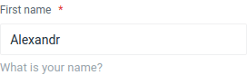
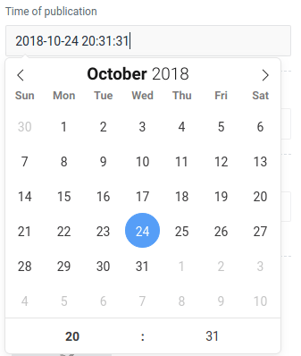
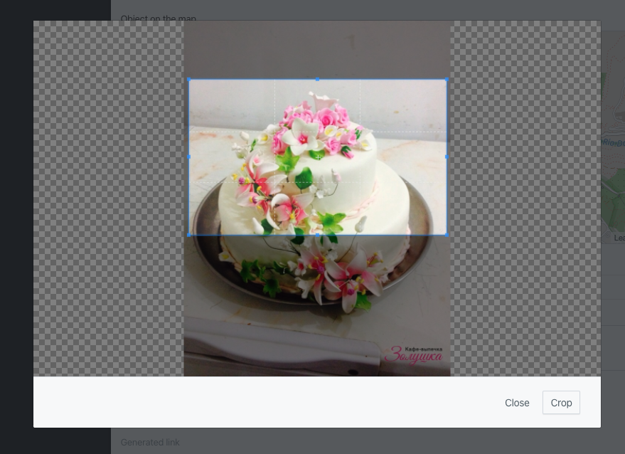

Fields are used to generate the output of the fill and edit form template. Form elements are the building blocks of a
user interface, and they allow you to create different parts of the interface and provide interaction with the user. In
this section, we will cover of the most common form elements and their usage.

> Feel free to add your fields, for example, to use the convenient editor for you or any components.

## Label

The Label field displays read-only text or a heading. Use it for section titles, hints, or to show a value that the user
cannot edit.

```php
use Orchid\Screen\Fields\Label;

Label::make('section_title')
    ->title('Shipping address');
```

You can bind a value from the screen's query so the label shows dynamic content (for example, a customer name). The same
methods (`title()`, `help()`, `popover()`, `vertical()`) are available as on other fields. Labels are often used inside
[reusable row layouts](/en/docs/screens#screen-layouts) to separate groups of fields.

## Introduction to Input

Input is one of the most versatile form elements. It allows you to create text fields, as well as other types of input
such as number, email, password, etc. Here is an example of creating a simple text input field:



Example:

```php
use Orchid\Screen\Fields\Input;

Input::make('name');
```

### Designing Input Interfaces

Empty and expressionless input fields can confuse the user, but you can help by specifying a title. The title should be
a short and descriptive label that clearly communicates the purpose of the field. Here is an example of how to add a
title to an input field:

```php
Input::make('name')
    ->title('First name');
```

If you need to provide additional context or instructions for the field, you can use the `help` method to add a hint or
brief description. The hint should be a short and concise message that helps the user understand the purpose or format
of the field. Here is an example of how to add a hint to an input field:

```php
Input::make('name')
    ->help('What is your name?');
```

If the field requires a more detailed explanation or guidance, you can use the `popover` method to add a tooltip that
will be displayed as a pop-up when the user hovers over the field. The tooltip should provide additional information or
instructions that help the user complete the field correctly. Here is an example of how to add a tooltip to an input
field:

```php
Input::make('name')
    ->popover('Tooltip - hint that user opens himself.');
```

By default, form elements are displayed in a horizontal layout, with the label and input field side by side. However,
you can change the layout to a vertical arrangement by using the `vertical()` method:

```php
Input::make('name')->vertical();
```

If you prefer the horizontal layout, you can use the `horizontal()` method to restore it:

```php
Input::make('name')->horizontal();
```

### Required Fields

Sometimes you may need to specify that a field is required, meaning that the user must enter a value in the field before
they can submit the form. To mark a field as required, you can use the `required()` method:

```php
Input::make('name')
    ->type('text')
    ->required();
```

You can also use the `required()` method on other types of form elements, such as select, radio buttons, and checkboxes.

### Hiding Input Fields

There may be times when you want to hide a form element from the user interface, either temporarily or permanently. To
hide a form element, you can use the `canSee()` method and pass a value of false:

```php
Input::make('name')->canSee(false);
```

If you want to show a previously hidden form element, you can use the canSee() method and pass a value of true:

```php
Input::make('name')->canSee(true);
```

> Note that many methods, such as `canSee`, `required`, `title`, `help`, `vertical`, `horizontal` and many others, are
> available in almost every `field` of the system.

### Types of Input

The `input` field is one of the most flexible fields. You can use it for text, file, hidden, and color values. It also
supports email, number, range, and URL values. The type attribute determines the kind of input field you want to create
and the kind of data it accepts. Here are some examples of using the `type` method:

```php
Input::make('name')->type('text');
```

A field for entering the name of the file that is sent to the server.

```php
Input::make('name')->type('file');
```

Hidden field.

```php
Input::make('name')->type('hidden');
```

Widget for choosing a color.

```php
Input::make('name')->type('color');
```

For email addresses.

```php
Input::make('name')->type('email');
```

Entering numbers.

```php
Input::make('name')->type('number');
```

Slider to select numbers in the specified range.

```php
Input::make('name')->type('range');
```

To specify web addresses.

```php
Input::make('name')->type('url');
```

> **Please note**. Please note that support for new HTML5 attributes such as `color` and `range` is dependent on the
> browser being used. You can learn more about attribute types at
> [Mozilla's website](https://developer.mozilla.org/en-US/docs/Web/HTML/Element/Input).

### Masking Input Values

A mask is a useful tool for enforcing a specific format for user input. For example, you might want to use a mask to
ensure that phone numbers are entered in a standard format, or that currency values are entered with the correct number
of decimal places.

To use a mask with an input field, you can use the `mask()` method and pass a string that defines the format of the
input. The string should contain placeholders for the allowed characters and any fixed characters that should be
included. Here is an example of using a mask to enforce a standard phone number format:

```php
Input::make('phone')
    ->mask('(999) 999-9999')
    ->title('Phone number');
```

You can also pass an array of options to the `mask()` method to customize the behavior of the mask. For example, you can
use the `numericInput` option to specify that only numeric characters should be accepted:

```php
Input::make('price')
    ->title('Price')
    ->mask([
        'mask' => '999 999 999.99',
        'numericInput' => true
    ]);
```

You can also use the `alias` option to use a predefined mask, such as `currency`, which automatically formats the input
as a currency value:

```php
Input::make('price')
    ->title('Price')
    ->mask([
        'alias' => 'currency',
        'prefix' => ' ',
        'groupSeparator' => ' ',
        'digitsOptional' => true,
    ]);
```

You can view all of the available options for the Inputmask library
[in the Inputmask options reference](https://github.com/RobinHerbots/Inputmask#options).

## Range

The Range field displays a numeric slider. Use it when the value is bounded and a visual slider is appropriate:

```php
use Orchid\Screen\Fields\Range;

Range::make('volume')
    ->min(0)
    ->max(100)
    ->step(1)
    ->title('Volume');
```

You can also use `Input::make('volume')->type('range')` for a native HTML5 range input. The Range field provides a
consistent Orchid-style interface.

## TextArea

The `textarea` field is a form element that allows the user to enter multiple lines of text. It is similar to the input
field, but it is designed to accept longer pieces of text and to preserve line breaks.

To create a `textarea` field, you can use the `TextArea` class:

```php
use Orchid\Screen\Fields\TextArea;

TextArea::make('description');
```

By default, the `textarea` field will expand to fit the amount of text that is entered. However, you can use the `rows`
method to specify a minimum number of rows:

```php
TextArea::make('description')
    ->rows(5);
```

This can be useful for providing a clear visual indication of the amount of text that is expected.

As with other form elements, you can use methods such as `title()`, `help()`, and `popover()` to add additional context
and guidance for the user. You can also use the `required()` method to mark the textarea field as `required` and the
`canSee()` method to show or hide the field.

## Password

The Password field is a text input that masks the value for sensitive data such as passwords:

```php
use Orchid\Screen\Fields\Password;

Password::make('password')
    ->title('Password')
    ->required()
    ->placeholder('Enter password')
    ->help('Minimum 8 characters.');
```

Use `title()`, `placeholder()`, `help()`, and `required()` as with other fields.

### Password visibility

Password includes a reveal control by default. Hide it with `Password::make('password')->revealable(false)`.
The control respects disabled fields and does not submit the form.

## CheckBox

A checkbox is a graphical user interface element that allows the user to control a parameter with two states - checked
and unchecked. Checkboxes are often used to represent binary choices, such as whether a particular feature is enabled or
disabled.

To create a checkbox field, you can use the `CheckBox` class:

```php
use Orchid\Screen\Fields\CheckBox;

CheckBox::make('free')
    ->value(1)
    ->title('Free')
    ->placeholder('Event for free')
    ->help('Event for free');
```

The `value` attribute determines the value that will be sent to the server when the checkbox is checked. The `title`
attribute provides a label for the checkbox, and the `placeholder` attribute can be used to provide a default value or a
short description. The `help` attribute can be used to provide additional context or instructions for the user.

By default, browsers do not send the value of an unchecked checkbox when the form is submitted. This can make it
difficult to use checkboxes with simple Boolean values. To solve this problem, you can use the `sendTrueOrFalse()`
method, which will send the value `false` to the server when the checkbox is unchecked:

```php
CheckBox::make('enabled')
    ->sendTrueOrFalse();
```

This can be useful for ensuring that the server receives a clear indication of the state of the checkbox.

## Switcher

The Switcher field renders a toggle ideal for boolean options such as "Enabled" or "Allow notifications." It is
well-suited for settings screens where a single on/off choice is needed.

```php
use Orchid\Screen\Fields\Switcher;

Switcher::make('notifications_enabled')
    ->title('Email notifications')
    ->sendTrueOrFalse()
    ->help('Receive email when someone comments.');
```

By default, an unchecked checkbox does not send a value. Use `sendTrueOrFalse()` so the server receives `true` or
`false` for the field.

> **Note.** For a list of multiple checkable options, use the [CheckBox](#checkbox) field. For a single on/off setting,
> Switcher is often the better choice.

## Select

Use Select for fixed options, Eloquent choices, enums, and remote model search.

```php
use Orchid\Screen\Fields\Select;

Select::make('status')->options([
    'draft' => 'Draft',
    'published' => 'Published',
]);

Select::make('user_id')->fromModel(User::class, 'email');
Select::make('user_id')->fromQuery(User::where('active', true), 'name', 'id');
```

`fromModel()` loads choices eagerly by default. `fromQuery()` always loads choices immediately;
use lazy `fromModel()` for remote searches.
The optional third argument selects the key column. Without it, the model's primary key is used, including UUID keys.

### Lazy model choices

```php
Select::make('user_id')
    ->lazy(20)
    ->fromModel(User::class, 'name')
    ->searchColumns('name', 'email')
    ->applyScope('active')
    ->allowEmpty();
```

Call `lazy()` before `fromModel()` to avoid eager loading. The default chunk size is 10.
`searchColumns()` sets the database columns searched by the remote endpoint.
`applyScope()` accepts the local scope name and optional arguments, for example `applyScope('forTenant', $tenantId)`.
Use a scope to restrict accessible choices. Encryption of the payload does not replace authorization.

Define scopes using Laravel's attribute syntax:

```php
use Illuminate\Database\Eloquent\Attributes\Scope;
use Illuminate\Database\Eloquent\Builder;

#[Scope]
protected function active(Builder $query): void
{
    $query->where('active', true);
}
```

`displayAppend('display_name')` can use a model accessor for the label in lazy mode.
Keep `searchColumns()` pointed at actual searchable database columns.
Existing selected values are resolved when the field is displayed.

### Selection options

```php
Select::make('assignees')->lazy()->fromModel(User::class, 'name')->multiple()->max(5);
Select::make('status')->fromEnum(Status::class, 'label');
Select::make('tags')->options(['laravel' => 'Laravel'])->multiple()->allowCreate();
Select::make('category')->options(['news' => 'News'])->empty('Choose a category', '');
```

`max()` limits selected items, while `lazy($chunk)` controls the remote result count.
The `Status` enum in the example must provide a `label()` method. Omit the second argument to use case names.
`allowCreate()` permits new values and replaces the deprecated `allowAdd()` name.
Validate submitted values on the server, including their ownership and existence.

The removed Relation field is replaced by `Select::make(...)->lazy()->fromModel(...)`.

## Radio

Use the Radio field for a single choice from a fixed set of options. Each option is displayed as a radio button:

```php
use Orchid\Screen\Fields\RadioButtons;

RadioButtons::make('status')
    ->options([
        'draft'   => 'Draft',
        'pending' => 'Pending',
        'published' => 'Published',
    ])
    ->value('draft')
    ->title('Status');
```

For a horizontal group of radio buttons in a single row, you can use the `RadioButtons` class or place multiple `Radio`
fields inside a [Group](#group). Use descriptive labels for accessibility.

## DateTime

The DateTime field provides a streamlined interface for selecting both date and time within your Laravel applications,
leveraging the robust functionality of the `flatpickr` JavaScript library.



To create a DateTime field, utilize the `DateTimer` class:

```php
use Orchid\Screen\Fields\DateTimer;

DateTimer::make('open')
    ->title('Opening date');
```

### Direct Input

Enable direct input to allow users to manually enter:

```php
DateTimer::make('open')
    ->title('Opening date')
    ->allowInput();
```

**Note:** enabling direct input can also make the field mandatory:

```php
DateTimer::make('open')
    ->title('Opening date')
    ->allowInput()
    ->required();
```

### Date Format

Customize the date format using the `format()` method:

```php
DateTimer::make('open')
    ->title('Opening date')
    ->format('Y-m-d');
```

Define the format for transmitting values to the frontend with the `serverFormat()` method:

```php
DateTimer::make('open')
    ->serverFormat('Y-m-d H:i:s');
```

Opt to display time in 24-hour format:

```php
DateTimer::make('open')
    ->title('Opening date')
    ->format24hr();
```

### Time Selection

Enable selection of both date and time using the `enableTime()` method:

```php
DateTimer::make('open')
    ->title('Opening time')
    ->enableTime();
```

### Time Selection Only

If only time selection is required:

```php
DateTimer::make('open')
    ->title('Opening time')
    ->noCalendar()
    ->format('h:i K'); // Specify time format
```

### Range Selection

Allow users to select a range for dates and times:

```php
DateTimer::make('open')
    ->format('Y-m-d H:i')
    ->enableTime()
    ->format24hr()
    ->range();
```

### Quick Date Selection

Facilitate easy selection with predefined quick date options:

```php
DateTimer::make('open')
    ->format('Y-m-d H:i')
    ->enableTime()
    ->format24hr()
    ->range()
    ->withQuickDates([
        'Today'     => now(),
        'Yesterday' => now()->subDay(),
        'Last Week' => [now()->startOfDay()->subWeek(), now()->endOfDay()],
    ]);
```

### Allow Empty Values

Allow the field to remain empty:

```php
DateTimer::make('open')
    ->format('Y-m-d')
    ->allowEmpty()
    ->multiple();
```

### Multiple Selection

Permit multiple date selections:

```php
DateTimer::make('open')
    ->format('Y-m-d')
    ->allowEmpty()
    ->multiple();
```

## DateRange

Allows you to select a range of date (and time).

Example:

```php
use Orchid\Screen\Fields\DateRange;

DateRange::make('open')
    ->title('Opening between');
```

Default value / result is an array with keys of `start`, `end`.

```php
DateRange::make('open')
    ->title('Opening between')
    ->value(['start' => now()->subDays(30), 'end' => now()]),
```

## TimeZone

The `TimeZone` field is a form element that allows the user to choose a time zone from a dropdown list. It is useful for
selecting the time zone in which an event or action will take place.

```php
use Orchid\Screen\Fields\TimeZone;

TimeZone::make('time');
```

This will create a dropdown list of all available time zones. You can also specify a specific set of time zones to
include in the list using the `listIdentifiers()` method:

```php
use DateTimeZone;

TimeZone::make('time')
    ->listIdentifiers(DateTimeZone::ALL);
```

The `listIdentifiers()` method takes a constant from the DateTimeZone class as an argument. The default value is
`DateTimeZone::ALL`, which includes all available time zones. Other possible values are:

```php
DateTimeZone::AFRICA;
DateTimeZone::AMERICA;
DateTimeZone::ANTARCTICA;
DateTimeZone::ARCTIC;
DateTimeZone::ASIA;
DateTimeZone::ATLANTIC;
DateTimeZone::AUSTRALIA;
DateTimeZone::EUROPE;
DateTimeZone::INDIAN;
DateTimeZone::PACIFIC;
DateTimeZone::UTC;
DateTimeZone::ALL_WITH_BC;
DateTimeZone::PER_COUNTRY;
```

The representation of variable zones can be found in the documentation
[PHP](https://www.php.net/manual/en/class.datetimezone.php).

## Quill WYSIWYG Editor

The Quill rich-text editor offers a seamless solution for integrating rich text editing capabilities into your web
applications. With Quill, users can effortlessly insert images, apply text styling, embed videos, and more.

To create a Quill editor instance, simply utilize the `Quill` field. Here's an example of how to implement it in your
code:

```php
use Orchid\Screen\Fields\Quill;

Quill::make('html');
```

### Toolbar Controls

Quill provides a comprehensive set of controls organized into six groups, empowering users with diverse editing
functionalities. These groups include:

- **Text**: Tools for basic text formatting such as bold, italic, underline, and strikethrough.
- **Color**: Options for adjusting text and background color.
- **Header**: Tools for styling text as headers.
- **List**: Controls for creating ordered and unordered lists.
- **Format**: Additional formatting options like alignment and indentation.
- **Media**: Features for inserting multimedia content such as images and videos.

You can customize the toolbar by specifying which groups of controls to display. Here's how you can configure the
toolbar in your code:

```php
Quill::make('html')
    ->toolbar(["text", "color", "header", "list", "format", "media"]);
```

### Extensibility

One of the strengths of Quill is its extensibility through plugins. You can enhance the editor's functionality by
installing additional plugins. This can be easily accomplished using a JavaScript file.

```javascript
document.addEventListener("orchid:quill", (event) => {
    // Object for registering plugins
    event.detail.quill;

    // Parameter object for initialization
    event.detail.options;
});
```

**Note:** you can add custom scripts and stylesheets through the `orchid.php` config file.

Example for [quill-image-compress](https://github.com/benwinding/quill-image-compress):

Add the following in `config/orchid.php` into the `resource.scripts` array

```text
"https://unpkg.com/quill-image-compress@1.2.11/dist/quill.imageCompressor.min.js",
"/js/admin/quill.imagecropper.js",
```

create a `quill.imagecropper.js` in `public/js/admin` with the following content

```js
document.addEventListener("orchid:quill", (event) => {
    // Object for registering plugins
    event.detail.quill.register("modules/imageCompressor", imageCompressor);

    // Parameter object for initialization
    event.detail.options.modules = {
        imageCompressor: {
            quality: 0.9,
            maxWidth: 1000, // default
            maxHeight: 1000, // default
            imageType: "image/jpeg",
        },
    };
});
```

## Markdown editor

Markdown uses CodeMirror and submits Markdown text. `SimpleMDE` remains a deprecated alias for this field.

```php
use Orchid\Screen\Fields\Markdown;

Markdown::make('post.body')
    ->title('Body')
    ->rows(12)
    ->toolbar([
        [Markdown::H2, Markdown::H3],
        [Markdown::BOLD, Markdown::ITALIC, Markdown::LINK],
        [Markdown::LIST, Markdown::ORDERED_LIST],
    ]);
```

Use `withoutToolbar()` to hide controls. Available identifiers include `H1` through `H5`, `BOLD`, `ITALIC`,
`LINK`, `QUOTE`, `CODE`, `LIST`, `ORDERED_LIST`, and `UPLOAD`.
Old SimpleMDE JavaScript options and extensions are not the current editor API.

## Matrix

The Matrix field provides a user-friendly interface for editing tabular data, offering flexibility and convenience. It's
particularly useful for scenarios where you need to manage structured data within a flat table format, such as storing
information in a JSON column type.

You can easily create a Matrix field by specifying the column headers. Here's an example of how to define a Matrix field
with columns:

```php
use Orchid\Screen\Fields\Matrix;

Matrix::make('options')
    ->columns([
        'Attribute',
        'Value',
        'Units',
    ]);
```

### Customizing Column Headers

In some cases, the values of the columns may differ from what needs to be displayed in the headers. You can address this
by specifying keys for the columns:

```php
Matrix::make('options')
    ->columns([
        'Attribute' => 'attr',
        'Value' => 'product_value',
    ]);
```

### Limiting Rows

You can also set a maximum number of rows, after which the add button will be disabled:

```php
Matrix::make('options')
    ->columns(['id', 'name'])
    ->maxRows(10);
```

### Custom Fields

By default, each cell in the Matrix field contains a textarea element. However, you can customize the field types
according to your requirements:

```php
Matrix::make('users')
    ->title('Users list')
    ->columns(['id', 'name'])
    ->fields([
        'id'   => Input::make()->type('number'),
        'name' => TextArea::make(),
    ]);
```

> It's important to note that the Matrix field performs field copying on the client side. While this works seamlessly
> for simple input and select fields, it may encounter limitations with complex or compound fields.

## Code editor

Code uses CodeMirror. Configure the language, line numbers, CSS height, and read-only state through field methods.

```php
use Orchid\Screen\Fields\Code;

Code::make('settings')
    ->language('json')
    ->lineNumbers()
    ->height('300px')
    ->readonly();
```

Supported language identifiers include `js`, `javascript`, `json`, `css`, `html`, `markup`, `xml`,
`svg`, `mathml`, and `clike`. Other identifiers fall back to JavaScript highlighting.
Array and object values are encoded as JSON for editing. TextArea remains a native multiline text field.

## Picture

Allows you to upload an image.

Example:

```php
use Orchid\Screen\Fields\Picture;

Picture::make('picture');
```

You can specify the storage backend for the uploaded image using the `storage` method:

```php
Picture::make('picture')
    ->storage('s3');
```

Use the `acceptedFiles` method to define the types of files that the field should accept. This is done using
[unique file type specifiers](https://developer.mozilla.org/en-US/docs/Web/HTML/Element/input/file#unique_file_type_specifiers).

For example, to only allow JPEG images, you can use the following code:

```php
Picture::make('picture')
    ->acceptedFiles('.jpg');
```

## Cropper

Extends Picture and allows you to upload an image and crop to the desired format.



Example:

```php
use Orchid\Screen\Fields\Cropper;

Cropper::make('picture');
```

### Width and Height

To control the format, you can specify the width and height of the desired image:

```php
Cropper::make('picture')
    ->width(500)
    ->height(300);
```

Or you can impose specific limits using `minWidth` / `maxWidth` or `minHeight` / `maxHeight` or use convenience methods
`minCanvas` / `maxCanvas`

```php
Cropper::make('picture')
    ->minCanvas(500)
    ->maxWidth(1000)
    ->maxHeight(800);
```

### File Size Limit

To limit the size of the downloaded file, you must set the maximum value in `MB`.

```php
Cropper::make('picture')
    ->maxFileSize(2);
```

### Value

The control of the return value is carried out using the methods:

```php
Cropper::make('picture')
    ->targetId();
```

The attachment primary key is returned. New installations use UUID strings, not integer sequence numbers.

```php
Cropper::make('picture')
    ->targetRelativeUrl();
```

Will return the relative path to the image.

```php
Cropper::make('picture')
    ->targetUrl();
```

Will return the absolute path to the image.

## Attach

The `Attach` field provides an intuitive interface for uploading images and files, including support for grouping and
sorting.

To create a file upload element, use the `make` method of the `Attach` class and specify the field name:

```php
use Orchid\Screen\Fields\Attach;

Attach::make('attachments');
```

To allow multiple file uploads, use the `multiple()` method:

```php
Attach::make('attachments')
    ->multiple();
```

### File Upload Limitations

For multiple file uploads, you can set a maximum number of files that can be uploaded using the `maxCount` method:

```php
Attach::make('attachments')
    ->multiple()
    ->maxCount(3); // 3 files
```

You can also limit the file size using the `maxSize()` method. The size is specified in megabytes (MB):

```php
Attach::make('attachments')
    ->maxSize(1024); // Size in MB
```

> **Maximum file upload size:** By default, the values for `upload_max_filesize` and `post_max_size` are set to 2M. You
> can change these settings in `php.ini` to allow file uploads larger than 2M.

Use the `accept` method to specify which file types the field should accept, for example:

```php
Attach::make('upload')
    ->accept('image/*,application/pdf,.psd');
```

The provided string is a list of
[unique file type specifiers](https://developer.mozilla.org/en-US/docs/Web/HTML/Element/input/file#unique_file_type_specifiers),
separated by commas.

### File Grouping

You can group files by different categories using the `group` method. This is particularly useful if you need to upload
different types of files, such as documents and images.

```php
Attach::make('docs')
    ->group('documents');

Attach::make('images')
    ->group('photo');
```

To work with uploaded files that are grouped through model relationships, use the following syntax:

```php
use Orchid\Attachment\Models\Attachment;

/**
 * Returns the attached "hero" (one-to-one).
 */
public function hero(): HasOne
{
    return $this->hasOne(Attachment::class, 'id', 'hero')
        ->withDefault();
}

/**
 * Returns documents (many-to-many).
 * Upload is handled via the group() method.
 */
public function documents(): MorphToMany
{
    return $this->attachments('documents');
}
```

### File Storage

The upload field can work with different repositories. To do this, specify the repository key defined in
`config/filesystems.php`:

```php
Attach::make('upload')
    ->storage('s3');
```

By default, the `public` storage is used.

### Explicit File Path Configuration

If you need to override the standard file storage rules and explicitly define the upload path, use the `path` method:

```php
Attach::make('upload')
    ->path('/custom/path');
```

### File Validation and Sorting on the Server

It’s important to validate files on the server side. For example, check that the file is an image with a specific aspect
ratio or file type. To do this, use the `uploadUrl` method to specify the endpoint for file uploads:

```php
Attach::make('upload')
    ->uploadUrl(route('my.upload.endpoint'));
```

Similarly, you can specify an endpoint for sorting files:

```php
Attach::make('upload')
    ->sortUrl(route('my.sort.endpoint'));
```

### Error Handling and Message Display

To ensure that users don’t encounter unclear errors, it’s important to provide clear and informative error messages. Use
the `errorMaxSizeMessage` and `errorTypeMessage` methods to specify custom messages:

```php
Attach::make('upload')
    ->errorMaxSizeMessage("File size is too large")
    ->errorTypeMessage("Invalid file type");
```

## Map

The Map field provides an interface for selecting or displaying a location (for example, coordinates). You can set the
initial zoom level and the height of the map container:

```php
use Orchid\Screen\Fields\Map;

Map::make('location')
    ->title('Location')
    ->zoom(12)
    ->height('400px');
```

The field typically stores coordinates, such as latitude and longitude. The Blade view may integrate with a map
provider, such as Leaflet or Google Maps, to render the map. Refer to the package resources or your custom view for
provider-specific setup.

## UTM

The UTM field is used to capture UTM parameters (campaign, source, medium, and related marketing fields). It is useful
in forms for tracking campaign and traffic source data:

```php
use Orchid\Screen\Fields\UTM;

UTM::make('campaign')
    ->title('Campaign parameters');
```

Use this field when you need to store or edit UTM metadata for analytics or marketing reports.

## Group

The `Group` component is used to combine multiple fields into a single line, allowing for more compact and organized
interfaces. This is especially useful for grouping related data, such as first and last names.

```php
Group::make([
    Input::make('first_name'),
    Input::make('last_name'),
]),
```

### Column Width

By default, fields will take up the full available width of the screen when you use the `fullWidth` method. This option
is suitable for most scenarios where you need elements to fill the entire space:

```php
Group::make([
    // ...
])->fullWidth();
```

However, there may be cases where you want fields to occupy only the necessary space. The `autoWidth` method is perfect
for situations where fields contain varying amounts of data. For example, when using radio buttons:

```php
Group::make([
    Radio::make('agreement')
        ->placeholder('Yes')
        ->value(1),

    Radio::make('contact')
        ->placeholder('No')
        ->value(0),
])->autoWidth();
```

For greater flexibility in configuring column widths, you can use the `widthColumns()` method, which supports CSS Grid.
This method allows you to specify column widths using values for the `grid-template-columns` property:

```php
Group::make([
    // ...
])->widthColumns('2fr 1fr');
```

Accepted values for `widthColumns()` include:

- Percentages (for example, `30%`)
- Pixels (for example, `120px`)
- Fractional units (for example, `2fr`)
- Other values such as `max-content` and `auto`

> **Important:** The number of specified values must not be less than the number of elements in the group.

The width settings apply only on desktop devices. On mobile devices, each field will be displayed on a new line,
enhancing the responsiveness of the interface and improving user experience.

### Column Alignment

Columns within a group can have different heights, especially when a header is present in only one of them. To create a
more visually appealing interface, it is essential to utilize column alignment.

When one of the columns has a header, aligning all columns to the bottom of the parent container will create a more
harmonious look. To achieve this, use the `alignEnd` method:

```php
Group::make([
    // ...
])->alignEnd();
```

If you want all elements to align at the top, apply the `alignStart` method:

```php
Group::make([
    // ...
])->alignStart();
```

To ensure that the columns are aligned along the baseline of the text for consistency in content display, use the
`alignBaseLine` method:

```php
Group::make([
    // ...
])->alignBaseLine();
```

For a symmetrical appearance, center the columns using the `alignCenter` method:

```php
Group::make([
    // ...
])->alignCenter();
```

## Button

Buttons are used to submit a form filled out by the user to the server.

To create a button that calls the `handler` method defined in the current screen, use `Button::make()`:

```php
Button::make('Submit')
    ->method('handler');
```

> The method must be available in the screen where the button is located.

If you need to pass specific data to the method, specify it as the second argument:

```php
Button::make('Submit')
    ->method('handler', [
        'user' => 1,
    ]);
```

### Action Confirmation

To prevent accidental actions, add the `confirm()` method. This will display a confirmation dialog before executing the
action. It is particularly useful for irreversible actions, such as data deletion.

```php
Button::make('Delete')
    ->method('deleteItem')
    ->confirm('You will lose access to this item.');
```

> **Tip:** Use clear and concise messaging in `confirm()` so the user understands the consequences.

### Submission URL

To specify the URL where the form data should be sent, use the `action()` method. Typically, this will be the URL of a
controller within your application where the request is processed after the button is clicked.

```php
Button::make('Submit')
    ->action('https://orchid.software');

Button::make('Submit')
    ->action(route('controller.method'));
```

### File Download

To initiate a file download when clicking a button, use the `download()` method. This signals the system that the result
of the method execution will be a downloadable file rather than simply displaying it in the browser.

```php
Button::make('Download Report')
    ->method('export')
    ->download();
```

## Link

Links (`Link`) are used to direct the user to another page or to perform an action, such as downloading a file.

To create a link to a specific URL, use `Link::make()` with the link text and the `href()` method:

```php
Link::make('Visit Orchid')
    ->href('https://orchid.software');
```

### Opening Link in a New Tab

To open a link in a new tab, add the `target('_blank')` method. This is useful for external sites or resources you want
to open alongside the current page.

```php
Link::make('Documentation')
    ->href('https://orchid.software/docs')
    ->target('_blank');
```

### File Download

If the link should initiate a file download, use the `download()` method. This informs the browser that the link points
to a downloadable file.

```php
Link::make('Download Report')
    ->href('/path/to/report.pdf')
    ->download();
```

> **Note:** Ensure the file is accessible at the specified path to avoid download errors.

## Dropdown Menu

The `Dropdown` component allows you to create a button with a dropdown list of actions, which is convenient for grouping
related actions, such as a three-dot menu for managing an item.

To create a dropdown menu, list all actions in the `list()` method:

```php
DropDown::make()
    ->icon('bs.options-vertical')
    ->list([
        Link::make('Edit')
            ->route('orchid.users.edit', $user->id),

        Button::make('Delete')
            ->method('remove')
            ->icon('trash'),
    ]);
```

## NumberRange

You can create ranges of numbers. Especially useful for filters.

```php
NumberRange::make();
```

Usage with filters:

```php
TD::make()->filter(NumberRange::make());
//or
TD::make()->filter(TD::FILTER_NUMBER_RANGE);
```

Result is an array with keys of `min`, `max`.

## Custom Fields Creation

To create custom fields, refer to the "Custom Fields" page in the documentation. This page provides a straightforward
guide on how to create and customize fields according to your requirements. Access the
[Custom Fields](/en/docs/custom-field) page for more details.

## KeyValue

KeyValue edits a map as rows containing `key` and `value` cells. Both cells accept scalar values or `null`.
Use an array cast for the model's `settings` attribute.

```php
use Orchid\Screen\Fields\KeyValue;

KeyValue::make('post.settings')
    ->keyLabel('Setting')
    ->valueLabel('Value')
    ->reorderable()
    ->value(['theme' => 'dark', 'locale' => 'en']);
```

The submitted value is a list of rows. Validate it before converting it back to a map:

```php
use Orchid\Screen\Fields\KeyValue;

$data = $request->validate([
    'post.settings' => ['nullable', 'array'],
    'post.settings.*.key' => ['nullable', 'string'],
    'post.settings.*.value' => ['nullable', 'string'],
]);

$post->settings = KeyValue::rowsToArray($data['post']['settings'] ?? []);
$post->save();
```

`rowsToArray()` ignores blank keys and keeps the last value for duplicate keys.
`addable()`, `deletable()`, `editableKeys()`, and `editableValues()` control the field's operations.
Rejected form input is restored for editing. Invalid nested model values throw an exception.

## BlockEditor

BlockEditor edits a JSON document with a top-level `blocks` list. It submits JSON text rather than HTML.
The current document format is independent of Editor.js.

```php
use Orchid\Screen\Fields\BlockEditor;

BlockEditor::make('post.body')
    ->toolbar([BlockEditor::PARAGRAPH, BlockEditor::HEADING, BlockEditor::IMAGE])
    ->value(['blocks' => [['type' => 'paragraph', 'text' => 'Hello']]]);
```

Toolbar identifiers are `PARAGRAPH`, `HEADING`, `QUOTE`, `LIST`, `IMAGE`, `CODE`, and `EMBED`.
Use `withoutToolbar()` to hide controls. The field accepts a JSON string or an array for its initial value.
A cleared document is represented by `{"blocks":[]}`.

For an array-cast model attribute, decode the validated JSON before assignment:

```php
$request->validate(['post.body' => ['nullable', 'json']]);

$post->body = json_decode(
    $request->input('post.body') ?: '{"blocks":[]}',
    true,
    flags: JSON_THROW_ON_ERROR,
);
$post->save();
```

Validate the permitted block structure for your application as well. Escape text when rendering stored blocks and
use an explicit policy for rich content and embeds. The field does not turn stored JSON into trusted HTML.

## Repeater

Repeater edits a list of records using full fields in each row. Use unprefixed field names inside `fields()`.
Use an array cast for the model's `links` attribute.

```php
use Orchid\Screen\Fields\Input;
use Orchid\Screen\Fields\Repeater;
use Orchid\Screen\Fields\Select;

Repeater::make('post.links')
    ->fields([
        Input::make('label')->title('Label'),
        Input::make('url')->type('url')->title('URL'),
        Select::make('kind')->options(['internal' => 'Internal', 'external' => 'External']),
    ])
    ->emptyRows(1)
    ->maxRows(10)
    ->cloneableRows()
    ->reorderableRows();
```

The example submits `post.links` as rows with `label`, `url`, and `kind`.
Client-side row limits do not replace server-side validation:

```php
$data = $request->validate([
    'post.links' => ['nullable', 'array', 'max:10'],
    'post.links.*.label' => ['required', 'string', 'max:255'],
    'post.links.*.url' => ['required', 'url'],
    'post.links.*.kind' => ['required', 'in:internal,external'],
]);

$post->links = $data['post']['links'] ?? [];
$post->save();
```

`emptyRows()` supplies initial blank rows. `maxRows()` limits the row count, and `removableRows()` controls deletion.
Nested repeaters and KeyValue fields are supported. Rows containing either cannot use `cloneableRows()`.
This restriction prevents nested values from being discarded during duplication.
For tabular scalar input, Matrix remains available.

## Attribute translation

Fields translate `title`, `placeholder`, and `help` by default.
Use `translatable()` to add attribute names and `withoutTranslation()` to exclude names, or all attributes:

```php
Input::make('title')->title('Title')->withoutTranslation('title');
Input::make('label')->translatable('value');
Input::make('text')->withoutTranslation();
```

These methods control interface text translation, not multilingual model storage.
To hide the required mark, use `Input::make('name')->required()->requiredWithoutAsterisk()`.
`requiredWithoutAsterisk()` changes the mark only; it does not make a field required.
Server-side validation is still required.
