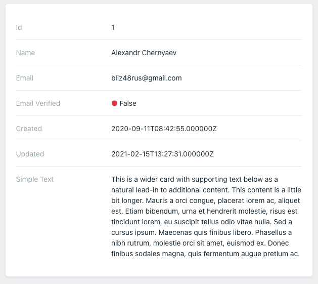

Legend displays one record as labeled values. Use `Sight` objects to choose the values to display.

## Display a record

Return the record from the screen's `query()` method and select it with `target()`:

```php
use Orchid\Screen\Layouts\Legend;
use Orchid\Screen\Repository;
use Orchid\Screen\Sight;

public function query(): array
{
    return [
        'user' => new Repository([
            'id' => 1,
            'name' => 'Alex',
            'email' => 'alex@example.com',
        ]),
    ];
}

public function layout(): iterable
{
    return [
        Legend::make([
            Sight::make('id'),
            Sight::make('name'),
            Sight::make('email'),
        ])->target('user'),
    ];
}
```

For default cell rendering, the selected record must be a `Repository` or a model using `Orchid\Screen\AsSource`.
Wrap a plain array in `new Repository($data)`. Without `target()`, Legend reads values from the root screen repository.
`Layout::legend($sights)` is an alias for `Legend::make($sights)`.



## Configure values

Use `popover()` to explain a value:

```php
Sight::make('id')->popover('Unique number in the system');
```

A `render()` callback receives the selected record. Return the value to display:

```php
Sight::make('name')->render(fn (Repository $user) => e(strtoupper($user->get('name'))));
```

Default values are escaped. Callback results are rendered as HTML, so escape untrusted text with `e()`.
For reusable rendering, use a Blade component. The component receives the selected record, as described in
[Table components](/en/docs/table#using-components).
