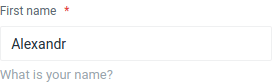
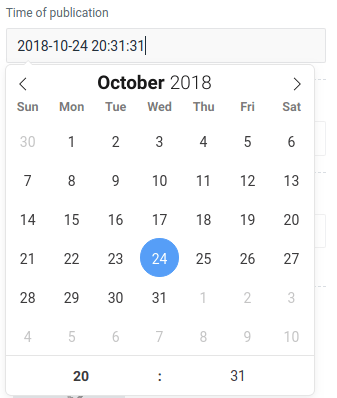
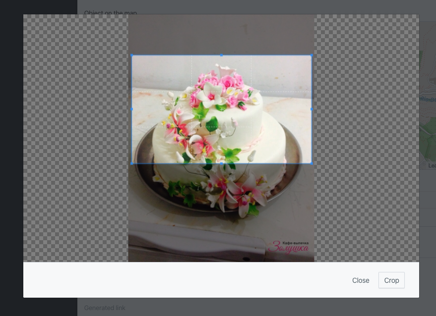

Поля используются для генерации вывода шаблона формы заполнения и редактирования.

> Не стесняйтесь добавлять свои поля, например, для использования удобного редактора для вас или любых компонентов.
> Документация по созданию ногового поля находится в разделе [Пользовательские поля.](/ru/docs/custom-field).

## Input

Является одним из разносторонних элементов формы и позволяет создавать разные части интерфейса и обеспечивать
взаимодействие с пользователем. Главным образом предназначен для создания текстовых полей.



Пример записи:

```php
use Orchid\Screen\Fields\Input;

Input::make('name');
```

### Пользовательское оформление

Пустые и невыразительные поля для ввода могут запутывать пользователя, но вы можете помочь, указав заголовок.

```php
Input::make('name')
    ->title('First name');
```

Когда требуется более подробно описать предназначение поля, тогда можно использовать подсказку:

```php
Input::make('name')
    ->help('What is your name?');
```

Если описание поля очень специфическое и требуется большое описание, можно использовать тултип, который будет показан в
качестве всплывающего окна:

```php
Input::make('name')
    ->popover('Tooltip - hint that user opens himself.');
```

Горизонтальное или вертикальное представление:

```php
Input::make('name')->vertical();
Input::make('name')->horizontal();
```

### Обязательное для заполнения

Иногда вам может потребоваться указать поле обязательным к заполнению, для этого необходимо вызвать метод `required`:

```php
Input::make('name')
    ->type('text')
    ->required();
```

### Скрытие полей

Иногда необходимо временно или на постоянной основе скрыть поле из пользовательского интерфейса. Для того чтобы скрыть
элемент формы, необходимо использовать метод `canSee` и передать в него значение `false`:

```php
Input::make('name')->canSee(false);
```

Если же Вы хотите отобразить скрытый элемент снова, то нужно использовать метод `canSee` и передать в него значение
`true`:

```php
Input::make('name')->canSee(true);
```

> Заметьте, многие методы, такие как `canSee`, `required`, `title`, `help`, `vertical`, `horizontal` и многие другие,
> доступны почти в каждом `поле` системы.

### Типы

Input - одно из самых универсальных полей за счет указания типа, поддерживаются все `html` значения:

> **Обратите внимание**. Поддержка новых HTML5 атрибутов полностью зависит от используемого браузера.

Текстовое поле. Предназначено для ввода символов с помощью клавиатуры.

```php
Input::make('name')->type('text');
```

Поле для ввода имени файла, который пересылается на сервер.

```php
Input::make('name')->type('file');
```

Скрытое поле.

```php
Input::make('name')->type('hidden');
```

Виджет для выбора цвета.

```php
Input::make('name')->type('color');
```

Для адресов электронной почты.

```php
Input::make('name')->type('email');
```

Ввод чисел.

```php
Input::make('name')->type('number');
```

Ползунок для выбора чисел в указанном диапазоне.

```php
Input::make('name')->type('range');
```

Для указания веб-адресов.

```php
Input::make('name')->type('url');
```

Более подробно о атрибуте `type` можно узнать на
[сайте Mozilla](https://developer.mozilla.org/en-US/docs/Web/HTML/Element/Input).

### Маска для ввода значений

Отлично подходит если значения должны быть записаны в стандартном виде, например ИНН или номер телефона

Пример записи:

```php
Input::make('phone')
    ->mask('(999) 999-9999')
    ->title('Номер телефона');
```

В маску можно передавать массив с параметрами, например:

```php
Input::make('price')
    ->title('Стоимость')
    ->mask([
     'mask' => '999 999 999.99',
     'numericInput' => true
    ]);
```

```php
Input::make('price')
    ->title('Стоимость')
    ->mask([
        'alias' => 'currency',
        'prefix' => ' ',
        'groupSeparator' => ' ',
        'digitsOptional' => true,
    ]);
```

Все доступные параметры _Inputmask_ можно посмотреть [здесь](https://github.com/RobinHerbots/Inputmask#options).

## TextArea

Поле `textarea` представляет собой элемент формы для создания области, в которую можно вводить несколько строк текста. В
отличие от тега `input` в текстовом поле допустимо делать переносы строк, они сохраняются при отправке данных на сервер.

Пример записи:

```php
TextArea::make('description');
```

Вы можете задать необходимое количество строк с помощью метода `rows`:

```php
TextArea::make('description')
    ->rows(5);
```

## CheckBox

Элемент графического пользовательского интерфейса, позволяющий пользователю управлять параметром с двумя состояниями —
☑ включено и ☐ выключено.

Пример записи:

```php
CheckBox::make('free')
    ->value(1)
    ->title('Free')
    ->placeholder('Event for free')
    ->help('Event for free');
```

По умолчанию браузеры не отправляют значения невыбранного поля. Это осложняет установку простых булевых типов. Для
решения этого есть отдельный метод, при использовании которого значение `false` будет отправлено:

```php
CheckBox::make('enabled')
    ->sendTrueOrFalse();
```

## Select

Select работает с готовыми вариантами, моделями Eloquent, enum и удалённым поиском.

```php
use Orchid\Screen\Fields\Select;

Select::make('status')->options([
    'draft' => 'Draft',
    'published' => 'Published',
]);

Select::make('user_id')->fromModel(User::class, 'email');
Select::make('user_id')->fromQuery(User::where('active', true), 'name', 'id');
```

`fromModel()` по умолчанию получает варианты сразу. `fromQuery()` всегда выполняет запрос немедленно;
для удалённого поиска используйте ленивый `fromModel()`.
Третий аргумент задаёт столбец ключа. По умолчанию используется первичный ключ модели, включая UUID.

### Ленивая загрузка вариантов

```php
Select::make('user_id')
    ->lazy(20)
    ->fromModel(User::class, 'name')
    ->searchColumns('name', 'email')
    ->applyScope('active')
    ->allowEmpty();
```

Вызывайте `lazy()` перед `fromModel()`, чтобы избежать полной загрузки. Размер порции по умолчанию равен 10.
`searchColumns()` задаёт столбцы базы для поиска.
`applyScope()` принимает имя локального scope и его аргументы, например `applyScope('forTenant', $tenantId)`.
Ограничивайте доступные записи через scope. Шифрование параметров не заменяет авторизацию.

Объявляйте scopes через атрибут Laravel:

```php
use Illuminate\Database\Eloquent\Attributes\Scope;
use Illuminate\Database\Eloquent\Builder;

#[Scope]
protected function active(Builder $query): void
{
    $query->where('active', true);
}
```

`displayAppend('display_name')` позволяет использовать accessor модели для подписи в ленивом режиме.
В `searchColumns()` оставляйте реальные столбцы базы. Уже выбранные значения разрешаются при отображении поля.

### Параметры выбора

```php
Select::make('assignees')->lazy()->fromModel(User::class, 'name')->multiple()->max(5);
Select::make('status')->fromEnum(Status::class, 'label');
Select::make('tags')->options(['laravel' => 'Laravel'])->multiple()->allowCreate();
Select::make('category')->options(['news' => 'News'])->empty('Choose a category', '');
```

`max()` ограничивает число выбранных элементов, а `lazy($chunk)` задаёт размер порции удалённых результатов.
Enum `Status` из примера должен иметь метод `label()`. Без второго аргумента используются имена вариантов.
`allowCreate()` разрешает новые значения и заменяет устаревшее имя `allowAdd()`.
Проверяйте значения, существование записей и принадлежность клиенту на сервере.

Удалённый Relation заменяется на `Select::make(...)->lazy()->fromModel(...)`.

## DateTime

Позволяет выбрать дату и время.



Пример записи:

```php
DateTimer::make('open')
    ->title('Opening date');
```

Разрешить прямой ввод:

```php
DateTimer::make('open')
    ->title('Opening date')
    ->allowInput();
```

**Обратите внимание**, что установка поля обязательным может быть только при условии прямого ввода:

```php
DateTimer::make('open')
    ->title('Opening date')
    ->allowInput()
    ->required();
```

Формат данных:

```php
DateTimer::make('open')
    ->title('Opening date')
    ->format('Y-m-d');
```

Пример, для отображения в 24-ом формате:

```php
DateTimer::make('open')
    ->title('Opening date')
    ->format24hr();
```

Календарь со временем:

```php
DateTimer::make('open')
    ->title('Opening time')
    ->enableTime();
```

Выбор только времени:

```php
DateTimer::make('open')
    ->title('Opening time')
    ->noCalendar()
    ->format('h:i K');
```

## DateRange

Позволяет выбрать диапазон даты (и времени).

Пример:

```php
DateRange::make('open')
    ->title('Opening between');
```

## TimeZone

Поле для удобного выбора часового пояса:

```php
TimeZone::make('time');
```

Указание конкретных часовых поясов возможно с помощью:

```php
use DateTimeZone;

TimeZone::make('time')
    ->listIdentifiers(DateTimeZone::ALL);
```

По умолчанию принимает значение `DateTimeZone::ALL`, но возможны и другие:

```php
DateTimeZone::AFRICA;
DateTimeZone::AMERICA;
DateTimeZone::ANTARCTICA;
DateTimeZone::ARCTIC;
DateTimeZone::ASIA;
DateTimeZone::ATLANTIC;
DateTimeZone::AUSTRALIA;
DateTimeZone::EUROPE;
DateTimeZone::INDIAN;
DateTimeZone::PACIFIC;
DateTimeZone::UTC;
DateTimeZone::ALL_WITH_BC;
DateTimeZone::PER_COUNTRY;
```

С представлением переменных зон можно ознакомиться в документации
[PHP](https://www.php.net/manual/ru/class.datetimezone.php).

## HTML редактор Quill

Такой редактор позволяет вставлять рисунки, таблицы, указывать стили оформления текста, видео.

Пример записи:

```php
Quill::make('html');
```

Доступно 6 групп элементов управления:

```php
Quill::make('html')
    ->toolbar(["text", "color", "header", "list", "format", "media"]);
```

Можно установить дополнительные плагины с помощью простого Javascript файла:

```js
document.addEventListener("orchid:quill", (event) => {
    // Object for registering plugins
    event.detail.quill;

    // Parameter object for initialization
    event.detail.options;
});
```

> **Примечание**: Вы можете добавлять пользовательские сценарии и таблицы стилей через файл конфигурации`orchid.php`.

Пример для [quill-image-compress](https://github.com/benwinding/quill-image-compress):

В файле `config/orchid.php` добавьте следующее в массив `resource.scripts` :

```text
"https://unpkg.com/quill-image-compress@1.2.11/dist/quill.imageCompressor.min.js",
"/js/admin/quill.imagecropper.js",
```

В директории `public/js/admin` создайте файл `quill.imagecropper.js` со следующим содержимым:

```js
document.addEventListener("orchid:quill", (event) => {
    // Object for registering plugins
    event.detail.quill.register("modules/imageCompressor", imageCompressor);

    // Parameter object for initialization
    event.detail.options.modules = {
        imageCompressor: {
            quality: 0.9,
            maxWidth: 1000, // default
            maxHeight: 1000, // default
            imageType: "image/jpeg",
        },
    };
});
```

## Markdown редактор

Markdown использует CodeMirror и отправляет текст Markdown. `SimpleMDE` сохранён как устаревший псевдоним поля.

```php
use Orchid\Screen\Fields\Markdown;

Markdown::make('post.body')
    ->title('Body')
    ->rows(12)
    ->toolbar([
        [Markdown::H2, Markdown::H3],
        [Markdown::BOLD, Markdown::ITALIC, Markdown::LINK],
        [Markdown::LIST, Markdown::ORDERED_LIST],
    ]);
```

`withoutToolbar()` скрывает панель. Доступны `H1`–`H5`, `BOLD`, `ITALIC`, `LINK`, `QUOTE`, `CODE`,
`LIST`, `ORDERED_LIST` и `UPLOAD`.
Старые JavaScript-параметры и расширения SimpleMDE не являются API текущего редактора.

## Matrix

Поле предоставляет удобный интерфейс для редактирования плоской таблицы. Например, вы можете хранить информацию внутри
столбца типа JSON:

```php
Matrix::make('options')
    ->columns([
        'Attribute',
        'Value',
        'Units',
    ])
```

Не всегда значения столбцов могут совпадать с тем, что нужно отображать в заголовках, для этого вы можете написать,
используя ключи:

```php
Matrix::make('options')
    ->columns([
        'Attribute' => 'attr',
        'Value' => 'product_value',
    ])
```

Возможно указание максимального количества строк, при достижении которого кнопка добавления не будет доступна:

```php
Matrix::make('options')
    ->columns(['id', 'name'])
    ->maxRows(10)
```

По умолчанию каждый элемент ячейки имеет поле textarea, но вы можете изменить его на свои собственные поля следующим
образом:

```php
Matrix::make('users')
    ->title('Users list')
    ->columns(['id', 'name'])
    ->fields([
        'id'   => Input::make()->type('number'),
        'name' => TextArea::make(),
    ]),
```

> **Примечание.** Матрица под капотом делает копирование полей на стороне клиента. Это хорошо работает для простых полей
> `input/select/etc`, но может не сработать для сложных или составных полей.

## Редактор кода

Code использует CodeMirror. Настройте язык, номера строк, высоту CSS и режим чтения методами поля.

```php
use Orchid\Screen\Fields\Code;

Code::make('settings')
    ->language('json')
    ->lineNumbers()
    ->height('300px')
    ->readonly();
```

Поддерживаются идентификаторы `js`, `javascript`, `json`, `css`, `html`, `markup`, `xml`,
`svg`, `mathml` и `clike`. Для неизвестного идентификатора используется подсветка JavaScript.
Массивы и объекты преобразуются в JSON для редактирования. TextArea остаётся обычным многострочным полем.

## Picture

Позволяет загружать изображение.

Пример записи:

```php
Picture::make('picture');
```

Поддерживаются файловые системы Laravel:

```php
Picture::make('picture')
    ->storage('s3');
```

Используйте метод `acceptedFiles`, чтобы определить типы файлов, которые должно принимать поле, например:

```php
Picture::make('picture')
    ->acceptedFiles('.jpg');
```

Передаваемая строка представляет собой список   [уникальных спецификаторов типов
файлов](https://developer.mozilla.org/en-US/docs/Web/HTML/Element/input/file#unique_file_type_specifiers), разделённый
запятыми.

## Cropper

Позволяет загружать изображение и обрезать до нужного формата.



Пример записи:

```php
Cropper::make('picture');
```

### Ширина и высота

Для того чтобы контролировать формат, можно указать ширину и высоту необходимого изображения:

```php
Cropper::make('picture')
    ->width(500)
    ->height(300);
```

Или вы можете установить определенные ограничения, используя `minWidth` / `maxWidth` или `minHeight` / `maxHeight` или
использовать удобные методы `minCanvas` / `maxCanvas`

```php
Cropper::make('picture')
    ->minCanvas(500)
    ->maxWidth(1000)
    ->maxHeight(800);
```

### Ограничение размера файла

Для ограничения размера загружаемого файла необходимо задать максимальное значение в `MB`

```php
Cropper::make('picture')
    ->maxFileSize(2);
```

### Значение

Контроль возвращаемого значения осуществляется с помощью методов:

```php
Cropper::make('picture')
    ->targetId();

// 20
```

Будет возвращён первичный ключ `Attachment`. В новой схеме это строковый UUID.

```php
Cropper::make('picture')
    ->targetRelativeUrl();

// /storage/2024/11/12/0ae30560194b944c656c548becd371b15b22cfba.jpg
```

Вернёт относительный путь до изображения.

```php
Cropper::make('picture')
    ->targetUrl();

// http://localhost/storage/2024/11/12/ade1a19e778ae64772a3e5348d32d5330c05893c.jpg
```

Вернёт абсолютный путь до изображения.

```php
Cropper::make('picture')
    ->path('some_path');

// http://localhost/storage/some_path/69dc36c754411788a35a7e108d3b57396ddbcedc.jpg
```

Вернёт абсолютный путь до изображения, заменив path на своё значение

## Attach

Поле обеспечивает интуитивно понятный интерфейс для загрузки изображений и файлов, включая поддержку группировки и
сортировки.

Для создания элемента загрузки файла используйте метод `make` класса `Attach`, указав имя поля:

```php
use Orchid\Screen\Fields\Attach;

Attach::make('attachments');
```

Чтобы разрешить множественную загрузку файлов, используйте метод `multiple()`:

```php
Attach::make('attachments')
    ->multiple();
```

### Ограничение загружаемых файлов

Для множественной загрузки с помощью метода `maxCount` можно задать максимальное количество файлов доступных для
загрузки:

```php
Attach::make('attachments')
    ->multiple()
    ->maxCount(3); // 3 файла
```

Также можно ограничить размер файлов с помощью метода `maxSize()`. Размер указывается в мегабайтах (MB):

```php
Attach::make('attachments')
    ->maxSize(1024); // Размер в MB
```

> **Максимальный размер загружаемого файла:** По умолчанию значения `upload_max_filesize` и `post_max_size` равны 2M. Вы
> можете изменить эти параметры в `php.ini`, чтобы установить максимальный размер файлов больше 2M.

Используйте метод `accept`, чтобы определить типы файлов, которые должно принимать поле, например:

```php
Attach::make('upload')
    ->accept('image/*,application/pdf,.psd');
```

Передаваемая строка представляет собой список
[уникальных спецификаторов типов файлов](https://developer.mozilla.org/en-US/docs/Web/HTML/Element/input/file#unique_file_type_specifiers),
разделённый запятыми.

### Группировка файлов

Вы можете группировать файлы по различным категориям с помощью метода `group`. Это особенно полезно, если нужно
загружать разные типы файлов, такие как документы и изображения.

```php
Attach::make('docs')
    ->group('documents');

Attach::make('images')
    ->group('photo');
```

Для работы с загруженными файлами для которых укзывается группы через отношения модели используйте следующий синтаксис:

```php
use Orchid\Attachment\Models\Attachment;

/**
 * Возвращает прикрепленный "hero" (один к одному).
 */
public function hero(): HasOne
{
    return $this->hasOne(Attachment::class, 'id', 'hero')
        ->withDefault();
}

/**
 * Возвращает документы (многие ко многим).
 * Загрузка осуществляется через метод group().
 */
public function documents(): MorphToMany
{
    return $this->attachments('documents');
}
```

### Работа с хранилищами файлов

Поле загрузки может работать с различными репозиториями. Для этого укажите ключ репозитория, указанный в
`config/filesystems.php`:

```php
Attach::make('upload')
    ->storage('s3');
```

По умолчанию используется хранилище `public`.

### Явная настройка пути к файлам

Если вам нужно игнорировать стандартные правила хранения файлов и явно указать путь для загрузки, используйте метод
`path`:

```php
Attach::make('upload')
    ->path('/custom/path');
```

### Валидация и сортировка файлов на сервере

Важно валидировать файлы и на серверной стороне. Например, проверить, что файл является изображением с определённым
соотношением сторон или соответствующим типом. Для этого используйте метод `uploadUrl`, чтобы указать endpoint для
загрузки файлов:

```php
Attach::make('upload')
    ->uploadUrl(route('my.upload.endpoint'));
```

Точно так же можно указать endpoint для сортировки файлов:

```php
Attach::make('upload')
    ->sortUrl(route('my.sort.endpoint'));
```

### Обработка ошибок и вывод сообщений

Для того чтобы пользователи не сталкивались с неясными ошибками, важно предоставить чёткие и информативные сообщения об
ошибках. Используйте методы `errorMaxSizeMessage` и `errorTypeMessage`, чтобы указать собственные сообщения:

```php
Attach::make('upload')
    ->errorMaxSizeMessage("Размер файла слишком большой")
    ->errorTypeMessage("Неверный тип файла");
```

## Group

Компонент `Group` используется для объединения нескольких полей на одной строке, что позволяет создавать более
компактные и организованные интерфейсы. Это особенно полезно для группировки связанных данных, таких как имя и фамилия.

```php
Group::make([
    Input::make('first_name'),
    Input::make('last_name'),
]),
```

### Ширина колонок

По умолчанию поля будут занимать всю доступную ширину экрана, если вы используете метод `fullWidth`. Этот вариант
подходит для большинства случаев, когда вам нужно, чтобы элементы заполняли всё пространство:

```php
Group::make([
    // ...
])->fullWidth();
```

Однако в некоторых случаях вам может понадобиться, чтобы поля занимали только необходимое пространство. Метод
`autoWidth` отлично подходит для ситуаций, когда поля содержат различный объем данных. Например, если вы используете
радиокнопки:

```php
Group::make([
    Radio::make('agreement')
        ->placeholder('Yes')
        ->value(1),

    Radio::make('contact')
        ->placeholder('No')
        ->value(0),
])->autoWidth();
```

Для большей гибкости в настройке ширины колонок вы можете использовать метод `widthColumns()`, который поддерживает CSS
Grid. Этот метод позволяет точно настраивать ширину колонок с использованием значений для свойства
`grid-template-columns`:

```php
Group::make([
    // ...
])->widthColumns('2fr 1fr');
```

Допустимые значения для `widthColumns()` включают:

- Проценты (например, `30%`)
- Пиксели (например, `120px`)
- Доли (fractional units) (например, `2fr`)
- Другие значения, такие как `max-content` и `auto`

> **Важно:** Количество указанных значений не должно быть меньше числа элементов в группе.

Настройки ширины применяются только на десктопных устройствах. На мобильных устройствах каждое поле будет отображаться
на новой строке, что улучшает отзывчивость интерфейса и делает его более удобным для пользователей.

### Выравнивание колонок

Колонки в группе могут иметь разную высоту, например, когда заголовок присутствует только в одной из них. Для создания
более привлекательного интерфейса важно использовать выравнивание колонок.

Когда в одной из колонок есть заголовок, выравнивание всех колонок по нижнему краю родительского контейнера поможет
сделать элементы более гармоничными. Для этого воспользуйтесь методом `alignEnd`:

```php
Group::make([
    // ...
])->alignEnd();
```

Когда вам нужно, чтобы все элементы располагались на одном уровне сверху, примените метод `alignStart`:

```php
Group::make([
    // ...
])->alignStart();
```

Чтобы обеспечить выравнивание колонок по базовой линии текста и добиться согласованности в отображении содержимого,
используйте метод `alignBaseLine`:

```php
Group::make([
    // ...
])->alignBaseLine();
```

Для достижения симметричного вида центрируйте колонки с помощью метода `alignCenter`:

```php
Group::make([
    // ...
])->alignCenter();
```

## Кнопка

Кнопки (`Button`) используются для отправки заполненной пользователем формы на сервер.

Чтобы создать кнопку, вызывающую метод `handler`, определённый в текущем экране, используйте `Button::make()`:

```php
Button::make('Отправить')
    ->method('handler');
```

> Метод должен быть доступен в текущем экране, где размещена кнопка.

Если вам необходимо передать определённые данные в метод, укажите их вторым аргументом:

```php
Button::make('Отправить')
    ->method('handler', [
        'user' => 1,
    ]);
```

### Подтверждение действия

Для предотвращения случайных действий добавьте метод `confirm()`, который отобразит окно подтверждения перед выполнением
операции. Это особенно полезно для необратимых действий, таких как удаление данных.

```php
Button::make('Удалить')
    ->method('deleteItem')
    ->confirm('Вы потеряете доступ к этому элементу.');
```

> **Совет:** Указывайте в `confirm()` чёткое сообщение, чтобы пользователь понимал последствия.

### Указание URL для отправки данных

Для указания URL, куда должна отправляться форма, используйте метод `action()`. Обычно это будет URL контроллера в
рамках вашего приложения, куда отправится запрос после нажатия кнопки.

```php
Button::make('Отправить')
    ->action('https://orchid.software');

Button::make('Отправить')
    ->action(route('controller.method'));
```

### Скачивание файла

Для начала скачивания файла по нажатию кнопки примените метод `download()`. Он указывает системе, что результатом
выполнения будет файл, который нужно загрузить, а не просто открыть в браузере.

```php
Button::make('Скачать отчёт')
    ->method('export')
    ->download();
```

## Ссылка

Ссылки (`Link`) используются для перенаправления пользователя на другую страницу или выполнения действия, такого как
скачивание файла.

Чтобы создать ссылку на определённый URL, используйте `Link::make()` с текстом ссылки и методом `href()`:

```php
Link::make('Посетить Orchid')
    ->href('https://orchid.software');
```

### Открытие ссылки в новой вкладке

Для открытия ссылки в новой вкладке добавьте метод `target('_blank')`. Это удобно для внешних ресурсов, которые нужно
открыть параллельно с текущей страницей.

```php
Link::make('Документация')
    ->href('https://orchid.software/docs')
    ->target('_blank');
```

### Скачивание файла

Если переход по ссылке должен инициировать скачивание файла, используйте метод `download()`. Это указывает браузеру, что
ссылка ведёт к файлу для загрузки.

```php
Link::make('Скачать отчёт')
    ->href('/path/to/report.pdf')
    ->download();
```

> **Примечание:** Убедитесь, что файл доступен по указанному пути, чтобы избежать ошибок при скачивании.

## Выпадающее меню (Dropdown)

`Dropdown` позволяет создать элемент с выпадающим списком действий, что удобно для группировки связанных действий под
одной кнопкой, например, в меню управления элементом.

Чтобы создать меню, перечислите все действия в методе `list()`:

```php
DropDown::make()
    ->icon('bs.options-vertical')
    ->list([
        Link::make('Редактировать')
            ->route('orchid.users.edit', $user->id),

        Button::make('Удалить')
            ->method('remove')
            ->icon('trash'),
    ]);
```

## NumberRange

Вы можете создавать диапазоны чисел. Особенно полезно для фильтров.

```php
NumberRange::make();
```

Использование с фильтрами:

```php
TD::make()->filter(NumberRange::make())
//or
TD::make()->filter(TD::FILTER_NUMBER_RANGE)
```

Результатом является массив с ключами `min`, `max`.

## Password

```php
use Orchid\Screen\Fields\Password;

Password::make('password')->title('Password')->revealable(false);
```

По умолчанию поле показывает кнопку видимости пароля. `revealable(false)` скрывает её.
Кнопка учитывает отключённое состояние поля и не отправляет форму.

## KeyValue

KeyValue редактирует карту через строки с ячейками `key` и `value`. Допустимы скалярные значения или `null`.
Добавьте array cast для атрибута модели `settings`.

```php
use Orchid\Screen\Fields\KeyValue;

KeyValue::make('post.settings')
    ->keyLabel('Setting')
    ->valueLabel('Value')
    ->reorderable()
    ->value(['theme' => 'dark', 'locale' => 'en']);
```

Форма отправляет список строк. Проверьте данные перед преобразованием в карту:

```php
use Orchid\Screen\Fields\KeyValue;

$data = $request->validate([
    'post.settings' => ['nullable', 'array'],
    'post.settings.*.key' => ['nullable', 'string'],
    'post.settings.*.value' => ['nullable', 'string'],
]);

$post->settings = KeyValue::rowsToArray($data['post']['settings'] ?? []);
$post->save();
```

`rowsToArray()` пропускает пустые ключи, для повторяющегося ключа остаётся последнее значение.
`addable()`, `deletable()`, `editableKeys()` и `editableValues()` управляют действиями поля.
После ошибки валидации введённые данные восстанавливаются. Вложенные значения модели вызывают исключение.

## BlockEditor

BlockEditor редактирует JSON-документ со списком `blocks` верхнего уровня и отправляет JSON, а не HTML.
Текущий формат документа не является форматом Editor.js.

```php
use Orchid\Screen\Fields\BlockEditor;

BlockEditor::make('post.body')
    ->toolbar([BlockEditor::PARAGRAPH, BlockEditor::HEADING, BlockEditor::IMAGE])
    ->value(['blocks' => [['type' => 'paragraph', 'text' => 'Hello']]]);
```

Доступные инструменты: `PARAGRAPH`, `HEADING`, `QUOTE`, `LIST`, `IMAGE`, `CODE` и `EMBED`.
`withoutToolbar()` скрывает панель. Начальное значение может быть JSON-строкой или массивом.
Пустой документ представлен как `{"blocks":[]}`.

Для атрибута модели с array cast декодируйте проверенный JSON перед присваиванием:

```php
$request->validate(['post.body' => ['nullable', 'json']]);

$post->body = json_decode(
    $request->input('post.body') ?: '{"blocks":[]}',
    true,
    flags: JSON_THROW_ON_ERROR,
);
$post->save();
```

Дополнительно проверяйте допустимую структуру блоков. Экранируйте текст при отображении сохранённых данных
и задайте правила для форматированного содержимого и вставок. Поле не превращает JSON в доверенный HTML.

## Repeater

Repeater редактирует список записей с полноценными полями в каждой строке.
В `fields()` задавайте имена без префикса родителя. Добавьте array cast для атрибута модели `links`.

```php
use Orchid\Screen\Fields\Input;
use Orchid\Screen\Fields\Repeater;
use Orchid\Screen\Fields\Select;

Repeater::make('post.links')
    ->fields([
        Input::make('label')->title('Label'),
        Input::make('url')->type('url')->title('URL'),
        Select::make('kind')->options(['internal' => 'Internal', 'external' => 'External']),
    ])
    ->emptyRows(1)
    ->maxRows(10)
    ->cloneableRows()
    ->reorderableRows();
```

Пример отправляет `post.links` как строки с `label`, `url` и `kind`.
Ограничения числа строк в интерфейсе не заменяют валидацию на сервере:

```php
$data = $request->validate([
    'post.links' => ['nullable', 'array', 'max:10'],
    'post.links.*.label' => ['required', 'string', 'max:255'],
    'post.links.*.url' => ['required', 'url'],
    'post.links.*.kind' => ['required', 'in:internal,external'],
]);

$post->links = $data['post']['links'] ?? [];
$post->save();
```

`emptyRows()` задаёт начальные пустые строки, `maxRows()` ограничивает их количество,
`removableRows()` управляет удалением. Вложенные Repeater и KeyValue поддерживаются,
но строки с такими полями нельзя дублировать через `cloneableRows()`.
Это ограничение предотвращает потерю вложенных значений. Для табличного ввода скаляров остаётся Matrix.

## Перевод атрибутов

Поля переводят `title`, `placeholder` и `help` по умолчанию.
Через `translatable()` добавляйте имена атрибутов, через `withoutTranslation()` исключайте выбранные или все:

```php
Input::make('title')->title('Title')->withoutTranslation('title');
Input::make('label')->translatable('value');
Input::make('text')->withoutTranslation();
```

Эти методы управляют переводом интерфейсного текста, а не хранением многоязычных значений модели.
Для скрытия звёздочки используйте `Input::make('name')->required()->requiredWithoutAsterisk()`.
`requiredWithoutAsterisk()` меняет только отметку, не делая поле обязательным.
Валидация на сервере по-прежнему необходима.
