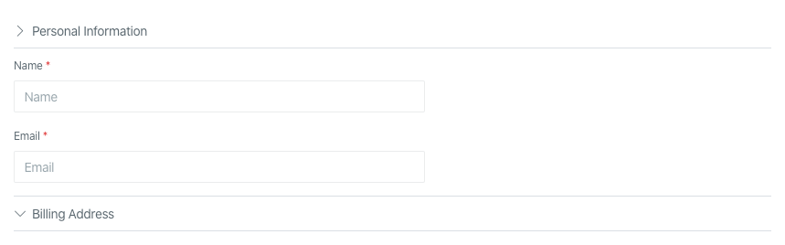
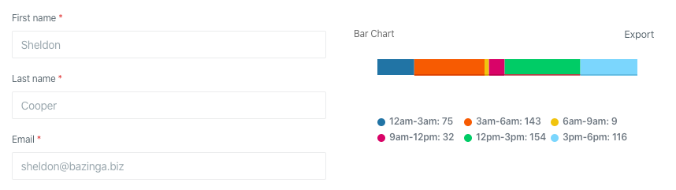
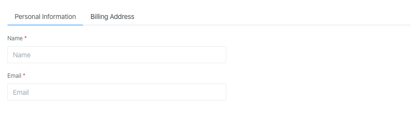

## Аккордеон

Аккордеоны полезны, когда Вы хотите переключаться между скрытием и отображением большого количества контента:



Аккордеоны поддерживают короткий синтаксис через вызов статического метода, что не требует создания отдельного класса:

```php
use Orchid\Screen\Layouts\Accordion;
use Orchid\Screen\Layouts\Rows;

public function layout(): array
{
    return [
        Accordion::make([
            'Personal Information' => [
                Rows::make([
                    Input::make('user.name')
                        ->type('text')
                        ->required()
                        ->title('Name')
                        ->placeholder('Name'),

                    Input::make('user.email')
                        ->type('email')
                        ->required()
                        ->title('Email')
                        ->placeholder('Email'),
                ]),
            ],
            'Billing Address'      => [
                Rows::make([
                    Input::make('address')
                        ->type('text')
                        ->required()
                        ->title('Адрес доставки')
                        ->placeholder('Ул. Ленина дом 14 оф.162'),
                ]),
            ],
        ]),
    ];
}
```

Ключи будут использованы в качестве заголовков.

Обратите внимание, что Вы можете указывать в качестве значений и имя класса в нижнем регистре:

```php
use Orchid\Screen\Layouts\Accordion;

public function layout(): array
{
    return [
        Accordion::make([
            'Personal Information' => PersonalInformationRow::class,
            'Billing Address'      => BillingAddressRow::class,
        ]),
    ];
}
```

## Колонки

Колонки полезны, когда Вам необходимо сгруппировать контент.



Колонки поддерживают короткий синтаксис через вызов статического метода, что не требует создания отдельного класса:

```php
use Orchid\Screen\Layouts\Columns;

public function layout(): array
{
    return [
        Columns::make([
            TableExample::class,
            RowExample::class,
        ]),
    ];
}
```

## Набор фильтров

Для группировки фильтров, их сброса и применения, существует отдельный слой `Selection`, в котором они указываются.

Для создания исполните команду:

```shell
php artisan orchid:selection MySelection
```

Пример класса:

```php
namespace App\Orchid\Layouts;

use Orchid\Filters\Filter;
use App\Orchid\Filters\CreatedFilter;
use App\Orchid\Filters\SearchFilter;
use Orchid\Screen\Layouts\Selection;

class MySelection extends Selection
{
    /**
     * @return Filter[]
     */
    public function filters(): array
    {
        return [
            SearchFilter::class,
            CreatedFilter::class,
        ];
    }
}
```

## Табы

Табы группируют контент и помогают в навигации. Полезны, когда Вы хотите переключаться между скрытием и отображением
большого количества контента:



Табы поддерживают короткий синтаксис через вызов статического метода, что не требует создания отдельного класса:

```php
use Orchid\Screen\Layouts\Rows;
use Orchid\Screen\Layouts\Tabs;

public function layout(): array
{
    return [
        Tabs::make([
            'Personal Information' => [
                Rows::make([
                    Input::make('user.name')
                        ->type('text')
                        ->required()
                        ->title('Name')
                        ->placeholder('Name'),

                    Input::make('user.email')
                        ->type('email')
                        ->required()
                        ->title('Email')
                        ->placeholder('Email'),
                ]),
            ],
            'Billing Address'      => [
                Rows::make([
                    Input::make('address')
                        ->type('text')
                        ->required()
                        ->title('Адрес доставки')
                        ->placeholder('Ул. Ленина дом 14 оф.162'),
                ]),
            ],
        ]),
    ];
}
```

Ключи будут использованы в качестве заголовков.

Обратите внимание, что Вы можете указывать в качестве значений и строчное имя класса:

```php
use Orchid\Screen\Layouts\Tabs;

public function layout(): array
{
    return [
        Tabs::make([
            'Personal Information' => PersonalInformationRow::class,
            'Billing Address'      => BillingAddressRow::class,
        ]),
    ];
}
```

По умолчанию активной является либо первая, либо последняя активная вкладка. сли вам нужно явно определить активную
вкладку, вы можете сделать это с помощью метода `->activeTab($key)`:

```php
use Orchid\Screen\Layouts\Tabs;

public function layout(): array
{
    return [
        Tabs::make([
            'Personal Information' => PersonalInformationRow::class,
            'Billing Address'      => BillingAddressRow::class,
        ])->activeTab('Billing Address'),
    ];
}
```

## Sortable

Sortable в платформе Orchid упрощает управление порядком элементов в вашем приложении. Вы сможете легко изменить порядок
элементов в вашем списке и создавать интерактивные пользовательские интерфейсы путем простой функции перетаскивания
(Drag & Drop) Это значительно облегчает работу с порядковыми элементами в пользовательском интерфейсе.

### Подготовка базы данных

Для начала использования функциональности сортировки, вам необходимо подготовить базу данных. Для этого создайте
миграцию, которая добавит простую целочисленную колонку в таблицу, с которой вы планируете работать. Вот пример
миграции:

```php
use Illuminate\Support\Facades\Schema;
use Illuminate\Database\Schema\Blueprint;
use Illuminate\Database\Migrations\Migration;

class AddOrderColumnToTable extends Migration
{
    /**
     * Run the migrations.
     *
     * @return void
     */
    public function up()
    {
        Schema::table('table_name', function (Blueprint $table) {
            $table->integer('order')->default(1);
        });
    }

    // ...
}
```

Замените `table_name` на имя таблицы, к которой нужно добавить колонку. Также вы можете выбрать любое другое имя для
колонки, заменив `'order'` на предпочитаемое.

> Не забудьте выполнить миграцию с помощью команды `php artisan migrate`, чтобы добавить новую колонку в базу данных.

### Подготовка Eloquent модели

После настройки базы данных и миграций добавьте трейт `Sortable` к вашей модели:

```php
use Illuminate\Database\Eloquent\Model;
use Orchid\Platform\Concerns\Sortable;

class Idea extends Model
{
    use Sortable;

    // ...
}
```

> Примечание: Обратите внимание, что необходимо импортировать класс модели Eloquent, а затем использовать трейт
> `Sortable`.

Если имя колонки отличается от `order`, можно добавить метод `getSortColumnName()` в вашу модель, чтобы явно указать имя
колонки:

```php
use Illuminate\Database\Eloquent\Model;
use Orchid\Platform\Concerns\Sortable;

class Idea extends Model
{
    use Sortable;

    // ...

    /**
     * Get the column name for sorting.
     *
     * @return string
     */
    public function getSortColumnName(): string
    {
        return 'sort';
    }
}
```

### Использование в экране

Теперь у нас есть подготовленная модель с функцией сортировки. Давайте создадим графический интерфейс для drag&drop
сортировки, в методе `query()` вашего экрана укажите список моделей, который будет отображаться для сортировки:

```php
use App\Models\Idea;
use Orchid\Screen\Repository;

public function query(): array
{
    return [
        'models' => Idea::sorted()->get(),
    ];
}
```

Здесь мы используем метод `sorted()`, предоставляемый трейтом `Sortable`, чтобы получить отсортированный список моделей.
Он так же имеет необязательный аргумент - направление сортировки (ASC - по возрастанию, DESC - по убыванию). По
умолчанию установлено значение ASC.

В методе `layout()` вашего экрана добавим графический интерфейс с использованием слоя `Sortable::make()`:

```php
use Orchid\Screen\Layouts\Sortable;
use Orchid\Screen\Sight;

public function layout(): iterable
{
    return [
        Sortable::make('models', [
            Sight::make('title'),
        ]),
    ];
}
```

## Сортировка с клавиатуры

Sortable поддерживает перестановку с клавиатуры. Используйте встроенную ручку и её подсказки управления.
При изменении шаблона сохраняйте фокус ручки и встроенные сообщения о перемещении.
