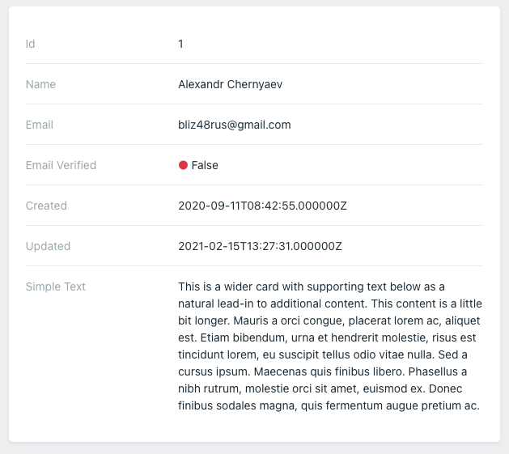

Макет легенда используется для просмотра одной модели:



Легенда поддерживает краткое написание без создания отдельного класса, например:

```php
use Orchid\Support\Facades\Layout;
use Orchid\Screen\Sight;

public function layout(): array
{
    return [
        Layout::legend([
            Sight::make('id'),
            Sight::make('name'),
            Sight::make('email'),
        ])->target('user'),
    ];
}
```

Передайте ячейки Sight в `Legend::make()` или `Layout::legend()`. Метод `target('user')` выбирает модель или массив
под ключом `user` из `query()` экрана. Без target используется корень репозитория.

Многие методы у класса `Sight` класса общие с `TD` (используется в [таблице](/en/docs/table/)). Например, можно добавить
пояснение:

```php
Layout::legend([
    Sight::make('id')->popover('Unique number in the system'),
])->target('user'),
```

Для того, чтобы использовать собственный шаблон или выполнить дополнительную обработку, вы можете использовать
замыкание, переданное в метод `render` :

```php
Layout::legend([
    Sight::make('id')->render(function (){
        return 'Any html';
    }),
])->target('user'),
```

Если такая обработка нужна часто, то более подходящим решением будет создать `Blade компонент`
([Подробнее](https://laravel.com/docs/blade#components)) и указать его:

```php
Layout::legend([
    Sight::make('id')->component(IdInformation::class),
])->target('user'),
```

Компоненты работают так же, как таблица. Вы можете увидеть больше примеров [здесь](/ru/docs/table#components).
