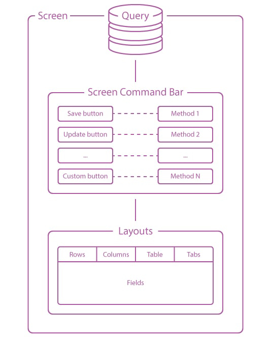

## Введение

Экран получает данные через `query()` и определяет их отображение через `layout()`.
Источником может быть база данных, API или внешний сервис. Макеты отображают значения, возвращённые из `query()`.
Метод `commandBar()` задаёт действия страницы, а публичные методы-обработчики принимают отправленные данные формы.

## Создание экранов

Вы можете создать новый экран, выполнив Artisan команду:

```php
php artisan orchid:screen Idea
```

В директории `app/Orchid/Screens` будет создан файл `Idea` со следующим содержанием:

```php
use Orchid\Screen\Screen;

class Idea extends Screen
{
    /**
     * Fetch data to be displayed on the screen.
     */
    public function query() : array
    {
        return [];
    }

    /**
     * The name of the screen is displayed in the header.
     */
    public function name(): ?string
    {
        return "Idea Screen";
    }

    /**
     * The screen's action buttons.
     *
     * @return \Orchid\Screen\Action[]
     */
    public function commandBar() : array
    {
        return [];
    }

    /**
     * The screen's layout elements.
     *
     * @return \Orchid\Screen\Layout[]|string[]
     */
    public function layout() : array
    {
        return [];
    }
}
```

Класс экрана включает несколько методов, которые можно использовать для определения поведения и внешнего вида экрана.
Эти методы включают:

- **query**: Этот метод загружает данные из базы данных или других источников. Он должен возвращать массив данных,
  которые будут доступны для макетов и представлений экрана.

- **commandBar**: Этот метод используется для определения кнопок и других действий, которые будут отображаться на
  экране.

- **layout**: Этот метод используется для определения структуры и содержимого экрана. Он должен возвращать массив
  объектов макета, которые могут использоваться для отображения данных, форм и других элементов на экране.



Для использования нового экрана в вашем приложении, вам нужно зарегистрировать его в файле маршрутов.

## Регистрация в маршрутах

Прежде чем быть доступными по прямому URL адресу, экраны, так же как и контроллеры, необходимо зарегистрировать в файле
маршрутов `/routes/orchid.php`. Записанные в него маршруты будут проходить через 'middleware', указанные в `private`
[конфигурации](/ru/docs/configuration). Зарегистрировать каждый экран можно с помощью метода `screen` у `Route`:

```php
use App\Orchid\Screens\Idea;

Route::screen('/idea', Idea::class)->name('orchid.idea');
```

С префиксом `/admin` по умолчанию экран доступен по адресу `/admin/idea`. Если вы изменили `orchid.prefix`,
используйте свой префикс.

Добавление экрана немного отличается от привычной регистрации, например, `GET` запроса, тем, что вместо одного адреса,
регистрируется целая группа. Для наглядности можно выполнить Artisan команду `route:list`:

```text
Method   | URI                      | Name
---------+--------------------------+--------------
GET|POST | admin/idea/{method?} | orchid.idea
```

Если вы регистрируете несколько маршрутов:

```php
use App\Orchid\Screens\Idea;
use App\Orchid\Screens\IdeaEdit;

Route::screen('/idea/edit', IdeaEdit::class)
    ->name('orchid.idea.edit');

Route::screen('/idea', Idea::class)
    ->name('orchid.idea');
```

> **Обратите внимание**, Routing Laravel выбирает первый подходящий маршрут.

Написав такие маршруты:

```php
Route::screen('/idea', Idea::class)->name('orchid.idea');
Route::screen('/idea/edit', IdeaEdit::class)->name('orchid.idea.edit');
```

Мы получаем:

```text
URI                           | Name
------------------------------+----------------------
admin/idea/{method?}      | orchid.idea
admin/idea/edit/{method?} | orchid.idea.edit
```

`{method?}` - означает необязательный аргумент, который может идти далее. Соответственно под него попадает имя "edit" в
адресе. В итоге будет редирект на "admin/idea/"

## Получение данных

Данные для показа на экране определяются в методе `query`, в котором должны происходить выборка или формирование
информации. Передача осуществляется в виде массива, ключи будут доступны в макетах, для их управления.

```php
public function query(): array
{
    return [
        'name'  => 'Alexandr Chernyaev',
    ];
}
```

В качестве источника может выступать модель `Eloquent`, для этого необходимо добавить трейт `AsSource` :

```php
namespace App\Models;

use Illuminate\Database\Eloquent\Model;
use Orchid\Screen\AsSource;

class Order extends Model
{
    use AsSource;
}
```

Пример, при котором в Layouts будут доступны ключи `order` и `orders`:

```php
public function query(): array
{
    return [
        'order'  => Order::find(1),
        'orders' => Order::paginate(),
    ];
}
```

Использование именно моделей `Eloquent` не обязательно, возможно использование массивов с помощью обёртки `Repository`:

```php
//...
use Orchid\Screen\Repository;
//...

public function query(): array
{
    return [
        'order'      => new Repository([
            'product_id' => 'prod-100',
            'name'       => 'Desk',
            'price'      => 10.24,
            'created_at' => '01.01.2020',
      ]),
    ];
}
```

## Автозаполнение публичных свойств

Возвращённые из метода `query` данные будут автоматически вставлены в объявленные публичные свойства в соответствии с их
именем. Например::

```php
/**
 * @var string
 */
public $message;

public function query(): array
{
    return [
        'message'  => 'Hello World!',
    ];
}

public function name(): ?string
{
    return $this->message;
}
```

При `GET` запросе заголовок страницы будет содержать слова «Hello world!».

## Обработка

В экранах предусмотрены встроенные команды, позволяющие пользователям выполнять различные пользовательские сценарии. За
это отвечает метод `commandBar`, в котором описываются требуемые кнопки управления.

Например:

```php
use Orchid\Screen\Actions\Button;
use Orchid\Support\Facades\Toast;

public function commandBar(): array
{
    return [
        Button::make('Вывести на печать')->method('print'),
    ];
}

public function print(): void
{
   Toast::warning('Привет мир!');
}
```

При нажатии кнопки вызывается метод `print()` экрана. Отправленные поля формы доступны через
`Illuminate\Http\Request`.

```php
// По нажатию будет вызван метод 'create'
use Orchid\Screen\Actions\Button;

Button::make('Новая функция')
    ->method('create');

// По нажатию будете перенаправлены на указанный адрес
use Orchid\Screen\Actions\Link;

Link::make('Внешняя ссылка')
    ->href('https://orchid.software');

// По нажатию будет показано модальное окно (CreateUserModal),
// в котором можно выполнить метод "save"
use Orchid\Screen\Actions\ModalToggle;

ModalToggle::make('Модальное окно')
    ->modal('CreateUserModal')
    ->method('save');
```

### Дублирование действий

В разработке программного обеспечения часто возникает необходимость выполнять похожие действия на нескольких экранах или
классах. Например, действие, такое как удаление объекта, может потребоваться как на экране с пагинацией, так и на экране
с подробной информацией. Вместо дублирования метода в обоих классах более эффективно использовать концепцию
наследования.

PHP предлагает мощную возможность наследования, при которой для сущности может быть создан базовый класс со своими
правами доступа и методами. Эти методы могут затем наследоваться конкретными экранами, что позволяет повторно
использовать код и уменьшает необходимость в избыточном коде. Это не только повышает эффективность процесса разработки,
но также упрощает поддержку кода и его понимание.

### Вызов метода экрана

При работе с экраном все действия пользовательского интерфейса имеют соответствующий метод, который выполняется при
вызове. Чтобы явно вызвать нужный метод из JavaScript или шаблона Blade, необходимо выполнить `POST` запрос к
специфическому маршруту. Свойство `method` должно быть указано в атрибутах с использованием функции-помощника
`route('orchid.screen.name', ['method' => 'hello'])`.

Например, чтобы вызвать метод `hello` на экране `orchid.screens.users`, можно использовать следующий код:

```blade
<form action="{{ route('orchid.screens.users', ['method' => 'hello']) }}"
      method="POST"
>
    @csrf
    <button type="submit">Отправить!</button>
</form>
```

Это отправит `POST` запрос на экран `orchid.screens.users` с атрибутом метода `hello`, который запустит
соответствующий метод на стороне сервера.

Вы также можете использовать это с кнопками пользовательского интерфейса:

```php
use Orchid\Screen\Actions\Button;

Button::make("Привет, мир!")
    ->action(route('orchid.screens.users', [
        'method' => 'hello',
    ]));
```

## Макеты

Верните макеты из метода `layout()` экрана. Макет может содержать другие макеты.
Например, Columns располагает форму рядом с таблицей:

```php
use Orchid\Screen\Fields\Input;
use Orchid\Screen\Layouts\Columns;
use Orchid\Screen\Layouts\Rows;
use Orchid\Screen\Layouts\Table;
use Orchid\Screen\TD;

public function layout(): iterable
{
    return [
        Columns::make([
            Rows::make([
                Input::make('order.name')->title('Name'),
                Input::make('order.price')->type('number')->title('Price'),
            ]),
            Table::make('orders', [
                TD::make('name'),
                TD::make('price'),
            ]),
        ]),
    ];
}
```

Форма читает значения из `order`, а таблица выводит записи из `orders`, возвращённые методом `query()`.
Выбор макетов описан в разделе [Макеты](/ru/docs/layouts).
Повторное использование форм описано в разделе [Rows](/ru/docs/rows).

## Дополнительные методы

### Сообщение валидации

```php
/**
 * Сообщение если форма не валидна.
 */
public function formValidateMessage(): string
{
    return 'Please check the entered data';
}
```

Этот метод возвращает сообщение, если валидация HTML-формы не прошла, например, если какое-то поле обязательно для
заполнения.

#### Предотвращение потери данных при переходе

Orchid предупреждает пользователя перед уходом с формы с несохранёнными изменениями.
По умолчанию это поведение включено настройкой `orchid.prevents_abandonment`.
Чтобы отключить предупреждение для отдельного экрана, верните `false`:

```php
public function needPreventsAbandonment(): bool
{
    return false;
}
```

## Подписанное состояние экрана

Orchid восстанавливает состояние экрана между запросами. Обычные значения и замыкания подписываются,
сохранённые модели Eloquent передаются как идентификаторы и повторно загружаются из базы.
Атрибут `#[WithoutRelations]` из `Illuminate\Queue\Attributes\WithoutRelations` на публичном свойстве модели
исключает восстановление загруженных связей. Используйте одинаковый `APP_KEY` между запросами и экземплярами приложения.

Подпись не заменяет авторизацию действий и проверку входных данных. В каждом обработчике проверяйте политики
и валидируйте запрос. Если решение зависит от изменений после показа экрана, читайте актуальное состояние базы.
