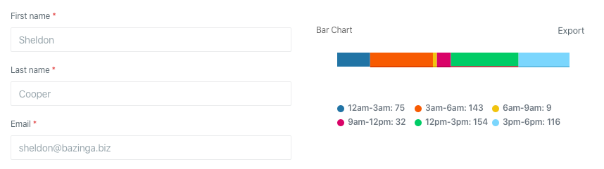

Columns are useful when you need to group content.



Columns support short syntax by calling a static method,
which does not require creating a separate class:

```php
use Orchid\Screen\Layout;

public function layout(): array
{
    return [
        Layout::columns([
           TableExample::class,
           RowExample::class,
        ]),
    ];
}
```
