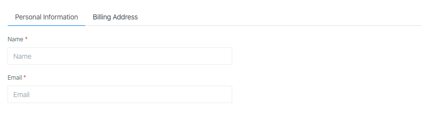

Tabs group content and help with navigation. Useful when you want to switch between hiding and displaying a lot of
content:



Tabs support short syntax by calling a static method,
which does not require creating a separate class:

```php
use Orchid\Support\Facades\Layout;

public function layout(): array
{
    return [
        Layout::tabs([
            'Personal Information' => [
                Layout::rows([
                    Input::make('user.name')
                        ->type('text')
                        ->required()
                        ->title('Name')
                        ->placeholder('Name'),

                    Input::make('user.email')
                        ->type('email')
                        ->required()
                        ->title('Email')
                        ->placeholder('Email'),
                ]),
            ],
            'Billing Address'      => [
                Layout::rows([
                    Input::make('address')
                        ->type('text')
                        ->required(),
                ]),
            ],
        ]),
    ];
}
```

Keys will be used as headers.

Please note that you can specify the lowercase name of the class as values:

```php
public function layout(): array
{
    return [
        Layout::tabs([
            'Personal Information' => PersonalInformationRow::class,
            'Billing Address'      => BillingAddressRow::class,
        ]),
    ];
}
```
