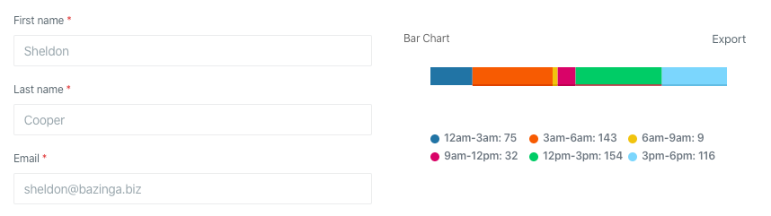

Колонки полезны, когда вам необходимо сгруппировать контент.



Колонки поддерживают короткий синтаксис через вызов статического метода,
что не требует создания отдельного класса:

```php
use Orchid\Support\Facades\Layout;

public function layout(): array
{
    return [
        Layout::columns([
           TableExample::class,
           RowExample::class,
        ]),
    ];
}
```
